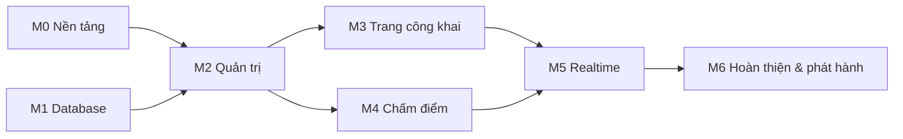

# 03 — Milestone và ticket

> Nguồn: [01-database-design.md](01-database-design.md) và [02-design-system.md](02-design-system.md). Ticket **không thêm tính năng mới**; nếu thấy thiếu, dừng lại và hỏi người dùng.
>
> Quy ước: mã ticket `M<số>-<số>`; "Phụ thuộc" là ticket phải xong trước; "Tham chiếu" là mục của tài liệu cần đọc; size: S (< nửa ngày), M (~1 ngày), L (1–2 ngày). Mọi ticket xong khi: chạy được `bun run dev`, `bun run check` và `bun run build` không lỗi, và đạt hết tiêu chí nghiệm thu.

## Tổng quan

M0 và M1 làm song song được (UI và database độc lập).

| Milestone | Mục tiêu | Kết quả kiểm chứng được |
|---|---|---|
| **M0 — Nền tảng** | Project chạy với shadcn, theme, Supabase client | Trang trống đúng theme, deploy thử lên Pages được |
| **M1 — Database** | Toàn bộ schema, RLS, RPC, test | Bộ test SQL (mục 9 file 01) qua hết |
| **M2 — Quản trị giải** | Ban tổ chức đăng nhập, tạo và cấu hình giải | Tạo được giải đầy đủ đội, bảng, lịch, đội hình, trọng tài |
| **M3 — Trang công khai** | Khán giả xem giải (chưa realtime) | Xem được danh sách giải, lịch, xếp hạng, chi tiết tie |
| **M4 — Chấm điểm** | Trọng tài và ban tổ chức chấm điểm | Chấm trọn một tie từ đầu đến cuối bằng điện thoại |
| **M5 — Realtime** | Tỉ số cập nhật trực tiếp | Hai trình duyệt: chấm ở một bên, bên kia tự đổi điểm |
| **M6 — Hoàn thiện** | Chất lượng, a11y, phát hành | Deploy production, chạy thử một giải thật |

---

## M0 — Nền tảng

### M0-1 Cài shadcn preset và dọn styles (S) — ✅ Hoàn thành
- **Việc:** chạy `bunx shadcn@latest init --preset b3DpidP3hY`; dọn `src/styles.css` (xóa Google Fonts, biến cũ của starter); kiểm tra `button.tsx` import `cn` từ `@/lib/utils` và gỡ gói `cn` nếu bị thêm.
- **Nghiệm thu:** `components.json` có `style: base-lyra`; `styles.css` chỉ còn token preset; font Inter và JetBrains Mono tải từ `@fontsource-variable`; không còn request tới Google Fonts; chuyển sáng/tối hoạt động.
- **Tham chiếu:** 02 §0.1, §0.2.

### M0-2 Token nghiệp vụ và biến thể kích thước (S) — ✅ Hoàn thành
- **Phụ thuộc:** M0-1.
- **Việc:** thêm token `team-a, team-b, live, win, warning` (sáng/tối) và đăng ký trong `@theme inline`; thêm size `touch` và `xl` cho `Button`, biến thể `live/win/warning` cho `Badge`; ô nhập `h-11 text-base md:h-8 md:text-xs` cho trang công khai/trọng tài.
- **Nghiệm thu:** tạo trang thử (route tạm, xóa sau) hiển thị đủ biến thể ở cả hai theme; vùng chạm ≥ 44px; tương phản chữ/nền ≥ 4.5:1.
- **Tham chiếu:** 02 §2.2, §2.4.

### M0-3 Cài các component shadcn (S) — ✅ Hoàn thành
- **Phụ thuộc:** M0-1.
- **Việc:** `bunx shadcn@latest add` toàn bộ danh sách ở 02 §3.1; đọc từng file trước khi dùng.
- **Nghiệm thu:** build qua; không component nào dùng `asChild`.

### M0-4 Dọn demo của starter và dựng khung layout (M) — ✅ Hoàn thành
- **Phụ thuộc:** M0-2, M0-3.
- **Việc:** xóa `src/routes/demo`, `about.tsx`, nội dung demo của Header/Footer; dựng 3 route layout rỗng: công khai (`/`), trọng tài (`/r`), quản trị (`/admin`); trang 404 thân thiện; nút đổi sáng/tối viết lại theo token mới; giữ `THEME_INIT_SCRIPT` hoặc tương đương để không bị nháy theme.
- **Nghiệm thu:** `bun run generate-routes` sinh đúng cây route; không còn tham chiếu tới file demo; 404 hiển thị đúng.
- **Tham chiếu:** 02 §4.

### M0-5 Supabase client và biến môi trường (S) — ✅ Hoàn thành
- **Việc:** cài `@supabase/supabase-js`; tạo `src/lib/supabase.ts` (chỉ dùng anon key); thêm `.env.example` với `VITE_SUPABASE_URL`, `VITE_SUPABASE_ANON_KEY`; kiểm tra `.env.local` đã gitignore.
- **Nghiệm thu:** thiếu biến môi trường thì app báo lỗi rõ ràng lúc khởi động; tìm trong repo không có `service_role`.
- **Tham chiếu:** AGENTS.md (Kiến trúc, Biến môi trường).

### M0-6 Deploy thử lên Cloudflare Pages (S) — ✅ Hoàn thành
- **Phụ thuộc:** M0-4.
- **Việc:** `wrangler pages project create giaicaulong` và `bun run deploy` (hoặc Git integration); đặt biến môi trường trên Pages; kiểm tra fallback SPA (mở thẳng route sâu như `/admin` không bị 404).
- **Nghiệm thu:** URL Pages mở được; refresh ở route bất kỳ vẫn ra app.
- **Lưu ý:** cần người dùng chạy `wrangler login`; nếu chưa có thì dừng lại và báo.

---

## M1 — Database

> Làm theo thứ tự migration ở 01 §8. Mỗi ticket là một hoặc vài file migration trong `supabase/migrations/`. Không sửa trực tiếp trên dashboard.

### M1-1 Khởi tạo Supabase CLI và project (S) — ✅ CLI linked, Email provider bật, Site URL/Redirect URLs đã xác nhận
- **Việc:** tạo project Supabase; `supabase init` và `supabase link`; bật Auth email (magic link); cấu hình Site URL và Redirect URL cho `localhost:3000` và domain Pages.
- **Nghiệm thu:** `supabase db push` chạy được với migration rỗng; magic link gửi được.
- **Lưu ý:** cần người dùng tạo project Supabase và cung cấp quyền; nếu chưa có, dừng và báo.

### M1-2 Enum và các bảng (M) — ✅ Migration reset sạch local và áp dụng trên project
- **Phụ thuộc:** M1-1.
- **Việc:** tạo toàn bộ enum (01 §2) và bảng (01 §3.1–3.11) gồm khóa, check, unique và index (01 §7).
- **Nghiệm thu:** `supabase db reset` chạy sạch; mọi bảng có `tournament_id` (trừ `tournaments`, `referee_tokens`); đúng tên cột theo tài liệu.

### M1-3 Trigger (M) — ✅ Test tạo 5 rubber, đội hình sai đội và organizer cuối; cascade xóa giải cũng qua
- **Phụ thuộc:** M1-2.
- **Việc:** (a) thêm `created_by` vào `tournament_organizers` sau khi tạo giải; (b) chặn xóa organizer cuối cùng; (c) sinh rubber theo `rubber_template` sau khi tạo tie; (d) sinh token sau khi tạo referee; (e) kiểm tra đội hình `rubber_players` (đúng đội, đúng phía, đúng số người).
- **Nghiệm thu:** test SQL cho từng trigger; tạo tie 5 rubber đúng thứ tự đơn–đôi–đơn–đôi–đơn.
- **Tham chiếu:** 01 §3.2, 3.6, 3.8, 3.11.

### M1-4 Hàm trợ giúp, RLS và quyền cột (L) — ✅ Test anon/public/draft, quyền ghi, cột hệ thống và cô lập organizer qua
- **Phụ thuộc:** M1-3.
- **Việc:** `is_organizer`, `is_tournament_visible`; bật RLS mọi bảng và viết policy theo ma trận 01 §4; `REVOKE UPDATE` rồi `GRANT UPDATE (cột)` cho `ties` và `rubbers`; chỉ cấp cho `anon` quyền `SELECT` bảng công khai.
- **Nghiệm thu:** test 1–3 của 01 §9 qua; `anon` không đọc được `referee_tokens`, không ghi được bảng nào.
- **Tham chiếu:** 01 §4.

### M1-5 RPC chấm điểm (L) — ✅ Workflow xác nhận assigned/unassigned token, start, undo, luật game, retired/walkover/tie; 12 score đồng thời không mất điểm
- **Phụ thuộc:** M1-4.
- **Việc:** `assert_can_score`, `start_rubber`, `score_point`, `undo_point`, `end_rubber_early`, `end_rubber_walkover`, `recompute_tie`; công thức kết thúc game; khóa dòng `FOR UPDATE`; `recompute_tie` không cấp EXECUTE cho client.
- **Nghiệm thu:** test 4, 6, 7, 8 của 01 §9 qua; 29–29 rồi 30–29 xong game; tie kết thúc khi 3 rubber, rubber còn lại `skipped`.
- **Tham chiếu:** 01 §5.1.

### M1-6 RPC ban tổ chức và trọng tài (S) — ✅ Add organizer, finish tournament, walkover và token invalidation qua
- **Phụ thuộc:** M1-4.
- **Việc:** `add_organizer_by_email`, `finish_tournament` (xóa referees), `referee_whoami`; cấp EXECUTE đúng role.
- **Nghiệm thu:** test 5 của 01 §9 qua; email không tồn tại trả `user_not_found`.
- **Tham chiếu:** 01 §5.2, 5.3.

### M1-7 View xếp hạng và Realtime publication (S) — ✅ Standings tính điểm/rubber đúng; publication đã xác minh
- **Phụ thuộc:** M1-5.
- **Việc:** view `group_standings` (`security_invoker`); thêm `ties, rubbers, games` vào publication `supabase_realtime`.
- **Nghiệm thu:** dữ liệu mẫu hai bảng cho thứ hạng đúng thứ tự tiêu chí; thay đổi `rubbers` phát sự kiện.
- **Tham chiếu:** 01 §3.12, §6.

### M1-8 Bộ test SQL và sinh type TypeScript (M) — ✅ `bun run test:db` (15 pgTAP tests + concurrent score check) qua; generated types committed-source-ready
- **Phụ thuộc:** M1-5, M1-6, M1-7.
- **Việc:** gom 8 test của 01 §9 vào `supabase/tests/` (pgTAP hoặc script SQL) kèm lệnh chạy ghi trong README; tạo `src/lib/database.types.ts` bằng `supabase gen types typescript`.
- **Nghiệm thu:** một lệnh chạy hết test và xanh; file type được commit.

---

## M2 — Quản trị giải

> Phụ thuộc chung: M0 và M1 xong.

### M2-1 Đăng nhập và route guard (M)
- **Việc:** trang `/login` (magic link, thông báo "Kiểm tra email của bạn"); callback xử lý phiên; guard cho `/admin/**` chuyển về `/login` khi chưa đăng nhập; nút đăng xuất.
- **Nghiệm thu:** chưa đăng nhập vào `/admin` bị chuyển; đăng nhập xong quay lại đúng trang đang vào; refresh vẫn giữ phiên.
- **Tham chiếu:** 02 §4.3.

### M2-2 Danh sách giải và tạo giải (M)
- **Việc:** `/admin` (danh sách giải của tôi, `Empty` khi chưa có); `/admin/tournaments/new` với slug gợi ý và kiểm tra trùng, luật mặc định điền sẵn, mẫu rubber 5 ô Đơn/Đôi; validate theo check ở 01 §3.1.
- **Nghiệm thu:** tạo giải xong người tạo tự là organizer; slug sai định dạng hoặc trùng bị từ chối với thông báo tiếng Việt.

### M2-3 Layout trang quản trị giải (S)
- **Phụ thuộc:** M2-2.
- **Việc:** `/admin/tournaments/$id` dùng `Sidebar` (mobile: `Sheet` hoặc tab dưới); 7 mục điều hướng; trang Tổng quan hiển thị trạng thái và số liệu cơ bản.
- **Nghiệm thu:** vào giải của organizer khác hiển thị như không tìm thấy.

### M2-4 Quản lý đội và VĐV (M)
- **Phụ thuộc:** M2-3.
- **Việc:** CRUD đội (`name`, `short_name` ≤ 4 ký tự, cờ emoji); CRUD VĐV; thêm nhanh nhiều VĐV bằng cách dán danh sách mỗi dòng một tên.
- **Nghiệm thu:** `short_name` trùng bị từ chối; xóa đội xóa luôn VĐV và có hộp xác nhận.

### M2-5 Bảng đấu (S)
- **Phụ thuộc:** M2-4.
- **Việc:** tạo, sửa, xóa bảng; xếp đội vào bảng.
- **Nghiệm thu:** xóa bảng làm `group_id` của đội thành null, không xóa đội.

### M2-6 Quản lý tie và tạo vòng tròn (L)
- **Phụ thuộc:** M2-5.
- **Việc:** danh sách tie; form tạo/sửa tie (giai đoạn, bảng, nhãn vòng, hai đội — cho phép để trống ở vòng loại trực tiếp, giờ, sân); nút "Tạo tự động vòng tròn cho một bảng" sinh mọi cặp trong bảng, bỏ qua cặp đã tồn tại.
- **Nghiệm thu:** bảng 4 đội sinh 6 tie, mỗi tie có 5 rubber; chạy lại không tạo trùng; không sửa được các cột hệ thống của tie.
- **Tham chiếu:** 02 §4.3, 01 §3.6.

### M2-7 Trọng tài: tạo, link, xóa (M)
- **Phụ thuộc:** M2-3.
- **Việc:** `/admin/tournaments/$id/referees`; thêm trọng tài chỉ cần nhập tên; `RefereeLinkCard` (sao chép link, Web Share API, xóa qua `alert-dialog`); link dạng `<origin>/r/<token>`.
- **Nghiệm thu:** token chỉ hiển thị ở trang này (organizer); xóa trọng tài khiến link cũ vô hiệu.
- **Tham chiếu:** 02 §3.2, 01 §3.10–3.11.

### M2-8 Đội hình và gán trọng tài cho rubber (L)
- **Phụ thuộc:** M2-6, M2-7.
- **Việc:** `/admin/tournaments/$id/ties/$tieId`; `LineupPicker` cho từng rubber (đơn 1 người, đôi 2 người, lọc theo đội, báo lỗi thiếu/sai số lượng); gán trọng tài từng rubber và nút "Gán cho tất cả"; sửa sân và giờ từng rubber.
- **Nghiệm thu:** không chọn được VĐV của đội khác; lỗi từ trigger hiển thị bằng tiếng Việt.

### M2-9 Thành viên ban tổ chức (S)
- **Phụ thuộc:** M2-3.
- **Việc:** danh sách organizer; thêm bằng email qua `add_organizer_by_email`; xóa (không xóa được người cuối cùng); thông báo `user_not_found` rõ ràng.
- **Nghiệm thu:** organizer mới thấy và sửa được giải; người cuối cùng không bị xóa.

### M2-10 Cài đặt giải: công khai và kết thúc (M)
- **Phụ thuộc:** M2-3.
- **Việc:** sửa thông tin giải; nút **Công khai giải** (`draft → published`, có xác nhận); nút **Kết thúc giải** qua `finish_tournament` với `alert-dialog` nêu rõ sẽ xóa mọi trọng tài và link.
- **Nghiệm thu:** sau khi kết thúc, danh sách trọng tài trống và link cũ trả "Link không còn hiệu lực".

### M2-11 Ánh xạ lỗi RPC và toast (S)
- **Việc:** hàm dùng chung chuyển mã lỗi (`forbidden`, `invalid_token`, `user_not_found`…) sang câu tiếng Việt; toast `sonner`; không bao giờ hiện lỗi thô của Postgres.
- **Nghiệm thu:** mọi form quản trị dùng chung hàm này.
- **Tham chiếu:** 02 §7. *Nên làm sớm trong M2 vì các ticket khác dùng.*

---

## M3 — Trang công khai

> Phụ thuộc chung: M2-6 (cần có dữ liệu giải). Có thể bắt đầu với dữ liệu mẫu seed.

### M3-1 Truy vấn dữ liệu công khai và component nền (M)
- **Việc:** hook TanStack Query cho giải, tie, rubber, game, đội, xếp hạng; `TeamName`, `LiveBadge`, `ScoreBoard`, `RubberCard`, `TieCard`, `StandingsTable` (chưa realtime); trạng thái tải bằng `Skeleton`.
- **Nghiệm thu:** các component hiển thị đúng với dữ liệu mẫu ở mọi trạng thái (`scheduled`, `live`, `finished`, `skipped`, tie chưa đủ đội); đội A xanh dương, đội B cam; không chỉ dùng màu để phân biệt.
- **Tham chiếu:** 02 §3.2, §6.

### M3-2 Trang chủ danh sách giải (S)
- **Phụ thuộc:** M3-1.
- **Việc:** route `/`; sắp xếp đang diễn ra → sắp tới → đã kết thúc; `LiveBadge` nếu có tie live; `Empty` khi chưa có giải.
- **Nghiệm thu:** giải `draft` không xuất hiện với khán giả.

### M3-3 Trang giải với các tab (L)
- **Phụ thuộc:** M3-1.
- **Việc:** `/t/$slug` với 5 tab (Trực tiếp, Lịch đấu, Bảng xếp hạng, Vòng loại trực tiếp, Đội); tab mặc định theo có tie live hay không; `StandingsTable` thu gọn cột trên mobile.
- **Nghiệm thu:** hiển thị tốt ở 360px; giải `draft` hoặc không tồn tại trả 404 giống nhau (không lộ sự tồn tại).

### M3-4 Trang chi tiết tie (M)
- **Phụ thuộc:** M3-1.
- **Việc:** `/t/$slug/ties/$tieId`; tỉ số tie cỡ lớn, `RubberCard` theo `position`; tự cuộn tới rubber đang live (một lần); "Chờ xác định đội" khi chưa đủ đội.
- **Nghiệm thu:** rubber `skipped` hiển thị mờ, gạch ngang, ghi "Không thi đấu".

---

## M4 — Chấm điểm

> Phụ thuộc chung: M1-5, M1-6, M2-7, M2-8.

### M4-1 Trang trọng tài `/r/$token` (M)
- **Việc:** gọi `referee_whoami`; chào tên; danh sách rubber được giao, rubber `live` đứng đầu; token sai hoặc giải đã kết thúc hiện "Link không còn hiệu lực".
- **Nghiệm thu:** trọng tài chỉ thấy rubber của mình; token không bị ghi vào log hay gửi đi nơi khác ngoài RPC.

### M4-2 Màn chấm điểm (L)
- **Phụ thuộc:** M4-1.
- **Việc:** `/r/$token/rubbers/$rubberId` theo đặc tả 02 §5: hai vùng điểm lớn chạm được, chuỗi điểm game, 2 nút hoàn tác, trạng thái `scheduled`/`live`/`finished`, nút "Bắt đầu trận" bị khóa kèm lý do khi thiếu đội hình hoặc đội; gọi `start_rubber`, `score_point`, `undo_point`.
- **Nghiệm thu:** chấm đủ một rubber 2–0 và một rubber 2–1; game kết thúc đúng công thức; rubber tự kết thúc.

### M4-3 Hành vi nâng cao của màn chấm điểm (M)
- **Phụ thuộc:** M4-2.
- **Việc:** cập nhật lạc quan và hoàn lại khi RPC lỗi; chống chạm đúp 250ms; rung `navigator.vibrate(15)`; `wakeLock` khi live; banner 3 giây khi hết game; cảnh báo và chặn chạm khi chắc chắn offline.
- **Nghiệm thu:** thử trên điện thoại thật; ngắt mạng thì hiện cảnh báo và không cho chấm.

### M4-4 Kết thúc sớm và xử thua (S)
- **Phụ thuộc:** M4-2.
- **Việc:** nút "Kết thúc sớm" mở `alert-dialog` chọn phía thắng, gọi `end_rubber_early`; trang quản trị có nút xử thua `end_rubber_walkover` cho rubber `scheduled`.
- **Nghiệm thu:** tie vẫn kết thúc đúng khi có rubber kết thúc sớm hoặc xử thua.

### M4-5 Ban tổ chức chấm thay (S)
- **Phụ thuộc:** M4-2, M2-8.
- **Việc:** từ trang tie ở khu quản trị mở màn chấm điểm dùng chung, không cần token; chấm được mọi rubber dù chưa gán trọng tài.
- **Nghiệm thu:** organizer chấm được rubber chưa gán; người không phải organizer và không có token bị `forbidden`.

---

## M5 — Realtime

> Phụ thuộc chung: M3 và M4 xong.

### M5-1 Hook subscribe và cập nhật cache (L)
- **Việc:** hook dùng `postgres_changes` cho `ties`, `rubbers`, `games` lọc theo `tournament_id`/`tie_id`; cập nhật bằng `setQueryData`; hủy subscribe khi rời trang; refetch toàn bộ khi kết nối lại hoặc khi tab được focus lại.
- **Nghiệm thu:** mở hai trình duyệt, chấm ở một bên thì bên kia đổi điểm trong khoảng 1–2 giây; tắt rồi bật mạng thì dữ liệu tự đồng bộ; không rò rỉ subscription khi chuyển trang.
- **Tham chiếu:** 01 §6.

### M5-2 ConnectionStatus và hiệu ứng điểm (M)
- **Phụ thuộc:** M5-1.
- **Việc:** `ConnectionStatus` hai trạng thái; khi mất kết nối **không xóa điểm đang hiển thị**; số điểm nháy sáng ~600ms khi đổi; vùng `aria-live="polite"` thông báo ngắn "Đội A 12, đội B 10"; tôn trọng `prefers-reduced-motion`.
- **Nghiệm thu:** bật giảm chuyển động thì nháy sáng và nhấp nháy tắt.
- **Tham chiếu:** 02 §2.6, §8.

### M5-3 Realtime cho màn chấm điểm và trang giải (S)
- **Phụ thuộc:** M5-1.
- **Việc:** màn chấm điểm tự cập nhật khi người khác chấm thay; tab Trực tiếp và Lịch đấu, trang chủ cập nhật trạng thái live.
- **Nghiệm thu:** rubber vừa bắt đầu xuất hiện ở tab Trực tiếp không cần tải lại trang.

---

## M6 — Hoàn thiện và phát hành

### M6-1 Trạng thái trống, tải, lỗi toàn app (M)
- **Việc:** rà từng màn theo bảng 02 §7: `Skeleton` đúng hình dạng, `Empty` có hướng dẫn, 404, lỗi mạng với nút "Thử lại".
- **Nghiệm thu:** danh sách kiểm tra từng màn được đánh dấu đủ trong mô tả PR.

### M6-2 Truy cập (a11y) và nội dung (M)
- **Việc:** thao tác bằng bàn phím; `focus-visible`; `aria-label` cho icon đơn; bảng ngữ nghĩa `<th scope>`; định dạng ngày `vi-VN` và múi giờ `Asia/Ho_Chi_Minh`; rà giọng văn và nhãn nút là động từ.
- **Nghiệm thu:** chạy Lighthouse accessibility ≥ 95 trên trang chủ, trang giải, màn chấm điểm.
- **Tham chiếu:** 02 §8.

### M6-3 Hiệu năng (S)
- **Việc:** tách code theo route; chỉ import font cần thiết; kiểm tra bundle trang công khai.
- **Nghiệm thu:** Lighthouse performance ≥ 90 trên trang công khai với mạng giả lập 4G chậm.
- **Tham chiếu:** 02 §9.

### M6-4 Kiểm thử đầu-cuối bằng thiết bị thật (M)
- **Phụ thuộc:** M5, M6-1.
- **Việc:** chạy kịch bản: tạo giải → thêm 4 đội → bảng → vòng tròn → đội hình → gán trọng tài → công khai → chấm trọn một tie bằng điện thoại → khán giả xem realtime → kết thúc giải; ghi lại lỗi và sửa.
- **Nghiệm thu:** kịch bản chạy hết không lỗi; ghi kết quả vào `docs/` (checklist đã tick).

### M6-5 Phát hành production và tài liệu vận hành (S)
- **Phụ thuộc:** M6-4.
- **Việc:** biến môi trường production trên Pages; Redirect URL của Supabase Auth; (tùy chọn) tên miền riêng; cập nhật README và AGENTS.md (đã làm xong gì, cách chạy test, cách tạo giải).
- **Nghiệm thu:** magic link đăng nhập production hoạt động; README đủ để người khác chạy lại từ đầu.

---

## Danh sách đầy đủ theo thứ tự đề xuất

| # | Ticket | Size | Phụ thuộc |
|---|---|---|---|
| 1 | M0-1 Cài shadcn preset | S | — |
| 2 | M0-5 Supabase client | S | — |
| 3 | M1-1 Supabase CLI | S | — |
| 4 | M0-2 Token nghiệp vụ | S | M0-1 |
| 5 | M0-3 Cài component | S | M0-1 |
| 6 | M1-2 Bảng | M | M1-1 |
| 7 | M0-4 Dọn demo, khung layout | M | M0-2, M0-3 |
| 8 | M1-3 Trigger | M | M1-2 |
| 9 | M0-6 Deploy thử Pages | S | M0-4 |
| 10 | M1-4 RLS | L | M1-3 |
| 11 | M1-5 RPC chấm điểm | L | M1-4 |
| 12 | M1-6 RPC tổ chức/trọng tài | S | M1-4 |
| 13 | M1-7 View, Realtime publication | S | M1-5 |
| 14 | M1-8 Test SQL và type | M | M1-5..7 |
| 15 | M2-11 Ánh xạ lỗi RPC | S | M0-3 |
| 16 | M2-1 Đăng nhập | M | M0, M1 |
| 17 | M2-2 Tạo giải | M | M2-1 |
| 18 | M2-3 Layout quản trị giải | S | M2-2 |
| 19 | M2-4 Đội và VĐV | M | M2-3 |
| 20 | M2-5 Bảng đấu | S | M2-4 |
| 21 | M2-6 Tie và vòng tròn | L | M2-5 |
| 22 | M2-7 Trọng tài | M | M2-3 |
| 23 | M2-8 Đội hình, gán trọng tài | L | M2-6, M2-7 |
| 24 | M2-9 Thành viên | S | M2-3 |
| 25 | M2-10 Cài đặt giải | M | M2-3 |
| 26 | M3-1 Truy vấn và component | M | M2-6 |
| 27 | M3-2 Trang chủ | S | M3-1 |
| 28 | M3-3 Trang giải | L | M3-1 |
| 29 | M3-4 Chi tiết tie | M | M3-1 |
| 30 | M4-1 Trang trọng tài | M | M2-7, M1-6 |
| 31 | M4-2 Màn chấm điểm | L | M4-1, M1-5 |
| 32 | M4-3 Hành vi nâng cao | M | M4-2 |
| 33 | M4-4 Kết thúc sớm, xử thua | S | M4-2 |
| 34 | M4-5 Ban tổ chức chấm thay | S | M4-2, M2-8 |
| 35 | M5-1 Hook realtime | L | M3, M4 |
| 36 | M5-2 ConnectionStatus, hiệu ứng | M | M5-1 |
| 37 | M5-3 Realtime màn chấm và trang giải | S | M5-1 |
| 38 | M6-1 Trạng thái trống/lỗi | M | M3 |
| 39 | M6-2 a11y và nội dung | M | M5 |
| 40 | M6-3 Hiệu năng | S | M5 |
| 41 | M6-4 Kiểm thử đầu-cuối | M | M5, M6-1 |
| 42 | M6-5 Phát hành | S | M6-4 |

## Việc cần chính chủ làm tay (agent không tự làm được)

- Tạo project Supabase, đưa URL và anon key vào `.env.local` và vào cài đặt build của Pages (M0-5, M1-1).
- `wrangler login` (M0-6) và quyền deploy lên Cloudflare.
- Chạy `npx @tanstack/intent@latest install` trong terminal tương tác (tùy chọn, ghi ở AGENTS.md).
- Mở link magic link trong email khi kiểm thử đăng nhập.
- Thử trên điện thoại thật (M4-3, M6-4).
