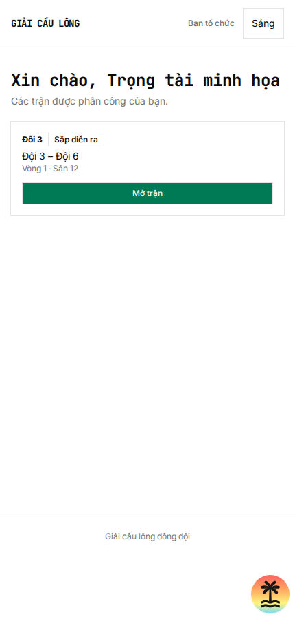
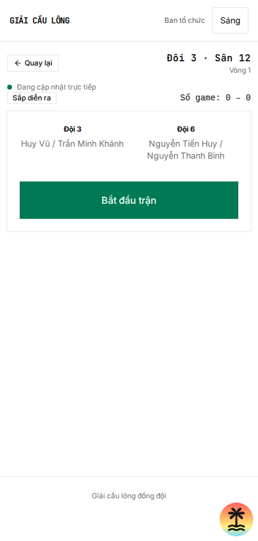
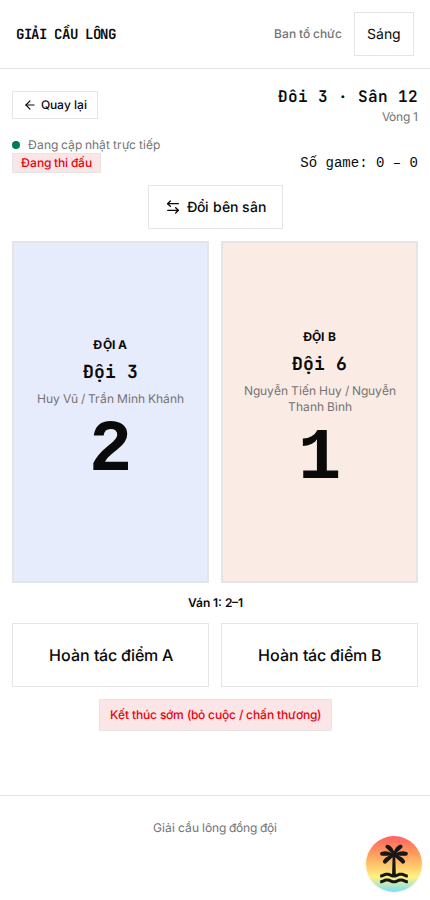
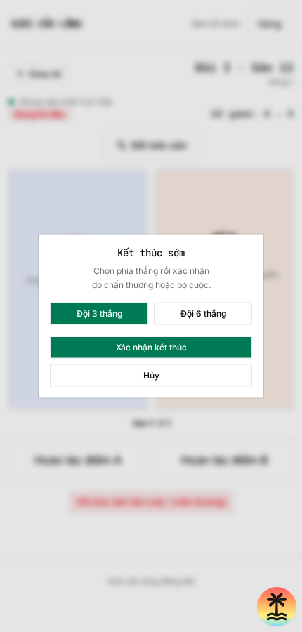

# Hướng dẫn chấm điểm cho trọng tài

## 1. Mở trận

- Mở **link riêng** do ban tổ chức gửi; bạn không cần đăng nhập. Giữ kín link, không chuyển cho người khác.
- Trong danh sách trận được phân công, chọn đúng trận và sân rồi bấm **Mở trận**. Kiểm tra hai đội và đội hình, sau đó bấm **Bắt đầu trận**.
- Nếu không thấy trận, thiếu đội hình hoặc link không còn hiệu lực, liên hệ ban tổ chức.

## 2. Chấm và sửa điểm

- **Cộng điểm:** chạm một lần vào ô lớn của đội vừa ghi điểm. Kiểm tra lại số điểm sau mỗi lần chạm.
- **Chấm nhầm:** bấm **Hoàn tác điểm A** hoặc **Hoàn tác điểm B** đúng với đội cần trừ. Chỉ hoàn tác được điểm trong ván đang đánh; nếu ván hoặc trận đã kết thúc, báo ban tổ chức.
- **Đổi sân:** bấm **Đổi bên sân** khi hai bên đổi phía. Hai ô điểm và nút hoàn tác sẽ đổi vị trí; tên đội và điểm vẫn thuộc đúng đội. Bấm lại để đổi về.
- Khi ván/trận đủ điểm theo luật giải, hệ thống tự cập nhật kết quả; sau trận bấm **Quay lại** để chọn trận tiếp theo.

## 3. Trường hợp cần chú ý

- **Bỏ cuộc hoặc chấn thương:** bấm **Kết thúc sớm**, chọn **đội thắng** rồi bấm **Xác nhận kết thúc**. Kiểm tra thật kỹ đội thắng trước khi xác nhận.
- **Mất mạng:** dừng chấm khi màn hình báo mất kết nối; điểm đang hiển thị được giữ lại và nút chấm tạm khóa. Khi có mạng lại, kiểm tra tỉ số đã đồng bộ trước khi tiếp tục. Nếu không đồng bộ, liên hệ ban tổ chức.

*Các ảnh là ví dụ trên dữ liệu thử; tên đội và sân trong trận của bạn có thể khác.*
